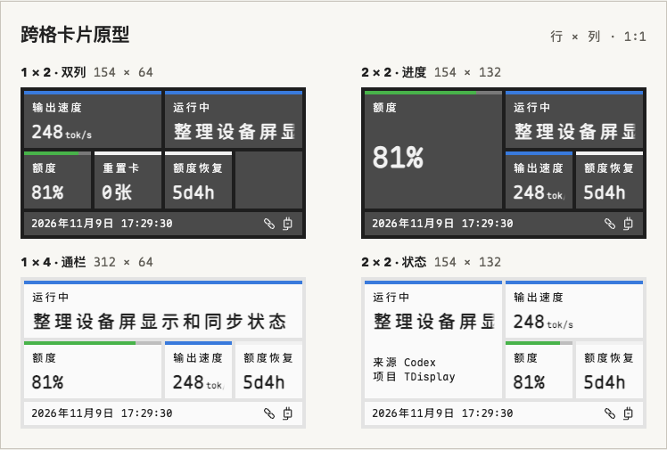

<p align="center">
  <picture>
    <source media="(prefers-color-scheme: dark)" srcset="public/brand/logo-dark.svg">
    
  </picture>
</p>

<h1 align="center">Mado</h1>

<p align="center">把 Codex 额度、电脑状态和关注的直播放到一块小屏上。</p>

<p align="center">
  <a href="#快速开始">快速开始</a> ·
  <a href="#连接实体屏">连接实体屏</a> ·
  <a href="docs/studio-guide.md">使用指南</a>
</p>

<p align="center">
  
</p>

## 简介

想看看 Codex 还有多少额度、GitHub 的 CI 跑完没有，或者关注的 UP 主开播没，不必在几个窗口间来回切。用 **Mado Studio** 把这些信息排成卡片，放到置顶桌面控件，或者同步到刷入 Mado 固件的 **LILYGO T-Display-C5 V1.0**。

只用电脑也可以开始。桌面控件和实体屏可以同时显示同一套布局。

## 它能做什么

- **看 Codex 和电脑状态**：查看 Codex 剩余额度、恢复倒计时、响应速度和任务状态。系统卡片可显示 CPU、内存、磁盘、网络速率和开机时长。
- **关注仓库和直播**：跟踪 GitHub 仓库的 PR、Issue 和 Actions 状态。B 站直播卡显示开播状态和 UP 主昵称，开播和下播时可发桌面通知。每个仓库或主播可以配置成独立实例。
- **按自己的习惯排版**：在 4 列 × 2 行的画布上拖放卡片，选择卡片规格和深浅配色，最多设置 5 页，并可开启自动轮播。
- **添加自己的数据**：用 JavaScript 编写采集器，读取 HTTP 接口或本地文件。在 Studio 里用样例试跑，预览卡片后再发布。

## 快速开始

当前版本可以从源码运行。以下命令以 macOS 为例，需要 Node.js 22.18+、Rust 和 [Tauri 构建依赖](https://v2.tauri.app/start/prerequisites/)。

```sh
git clone https://github.com/Mr9esx/Mado.git
cd Mado
npm ci
npm run tauri dev
```

1. 打开 Studio，从左侧组件库把卡片拖到预览画布。系统采集器会自动读取本机数据。
2. 点击「应用布局」保存。再点窗口顶部的「桌面控件」，就能把看板放在桌面上。
3. 想加 Codex 卡片，先在组件库打开 Codex 设置并连接本机 CLI。要添加 GitHub 仓库或 B 站 UP 主，打开「管理采集器」，填写实例参数并启用。详见 [Codex 连接](docs/studio-guide.md#连接-codex)和[内置采集器](docs/builtin-collectors.md)。

## 连接实体屏

先按[构建与烧录说明](docs/firmware-resources.md#构建与烧录)为 **LILYGO T-Display-C5 V1.0** 准备固件。然后打开 Studio 预览底栏的设备连接面板，选择一种方式：

- **USB**：接上 USB 数据线，选择设备端口，再点「连接设备」。第一次使用可以从 USB 开始。
- **蓝牙（macOS）**：长按开发板的 BOOT 键进入设置，在设备上开启「蓝牙配对」。回到 Studio 扫描并连接，按系统提示输入屏上的六位码。
- **Wi-Fi（预览）**：先用 USB 或已配对的蓝牙连接，在 Studio 里选择「配置 Wi-Fi」。电脑和屏幕需要在能互通的局域网内。局域网发现和同步仍待实机验证。

连接后，实体屏使用最近一次「应用布局」保存的页面。配对按键、手动填写 IP 和重连说明见[设备连接指南](docs/studio-guide.md#连接实体屏)。

## 常见问题

**没有开发板，可以用 Mado 吗？**

可以。打开 Studio 的「桌面控件」就能看实时数据；关闭编辑器后，控件和采集会继续运行。

**需要部署服务吗？**

无需单独部署服务。Studio 在电脑上运行采集和显示。系统指标来自本机，GitHub 和 B 站等在线数据源需要联网。

**为什么有些卡片没有读数？**

先在「管理采集器」确认对应实例已启用并配置了所需参数。Codex 需要本机 CLI 和 ChatGPT 登录。新增卡片后点「应用布局」，桌面控件和设备才会使用新布局。

## 文档

- [Studio 使用指南](docs/studio-guide.md) · 布局、桌面控件、Codex、设备连接和源码开发
- [内置采集器](docs/builtin-collectors.md) · 系统、GitHub 和 B 站的配置
- [采集器 SDK](docs/display-config-model.md#sdk) · 编写、试跑和发布采集器
- [固件与烧录](docs/firmware-resources.md#构建与烧录) · 实体屏构建和升级
- [总体设计](docs/design.md) · 架构、显示协议和屏幕 UI

遇到问题或有想要的功能，欢迎到 [GitHub Issues](https://github.com/Mr9esx/Mado/issues) 提出。
