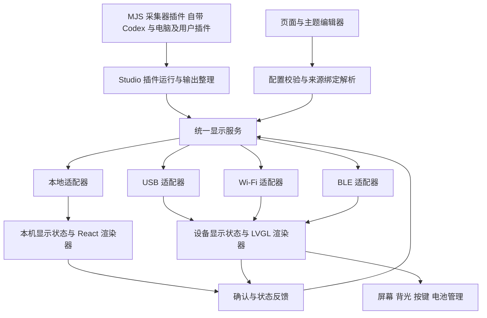

# Mado 总体设计

更新日期：2026-11-10。本文是项目设计的统一入口，描述目标架构、已确认的产品决定及当前实现边界。专项文档维护各自领域的详细契约；`docs/superpowers/` 下的文档保留为阶段设计记录，不作为另一套现行协议。

## 设计文档索引

| 文档 | 内容与权威范围 |
| --- | --- |
| [总体设计](design.md) | 系统边界、模块职责、实现状态和待定项 |
| [统一显示协议](display-protocol.md) | 完整消息列表、消息结构、适配器、确认重试、事件时序和重连 |
| [屏幕配置数据模型](display-config-model.md) | 采集器 SDK、输出契约、卡片配置和六类读数的字段 |
| [设备屏 UI 规范](display-ui.md) | 像素布局、字体尺寸、颜色、图标、滚动和动画行为 |
| [固件与显示资源](firmware-resources.md) | 硬件、LVGL、字体分片与缓存、IconPark 素材、Flash 和更新 |
| [项目说明](../README.md) | 启动、用户操作和开发检查 |

协议负责消息生命周期，数据模型负责消息中的业务字段，UI 规范负责呈现规则。发生冲突时按上述责任归属修订原文，不在多处复制整份规则。

## 已确认的决定

- MJS 插件拥有采集与业务计算。Studio 运行插件、解析来源绑定、组装统一显示帧；显示端根据结构化配置与读数自主渲染和播放。
- 本机与实体屏共用配置和读数投影。当前实现本地与 USB，Wi-Fi 和 BLE 保留传输接口。
- 页面数量、顺序、名称、布局、主题和轮播参数随完整配置一起提交；实时读数独立更新；切页独立于配置修改。
- v1 每帧发送所有页面、所有已配置卡片的全量读数，缺数据明确用 `null`。全量传输不意味着全量重绘。
- 断线后保留最近读数并继续播放，状态栏标记断开并保留最后读数更新时间；重连恢复最新快照，不补播积压提醒。
- 实体屏使用 LVGL；文本使用 Maple Mono CN Regular，通过 FreeType 选择字号和模拟加粗；图标独立使用 IconPark。
- 字体分片数量是构建参数，不固定为 23；以完整字符覆盖、内存预算和实板性能决定最终分组。
- 固件采用单应用槽、USB 更新，字体和持久化配置与应用资源分离。

## 总架构

USB、Wi-Fi 与 BLE 是同一设备的不同通道，不是两个独立显示目标。按稳定的 `deviceId` 识别设备，v1 每个目标只允许一个活动控制会话。桌面与实体屏可以同时工作；一个目标失败不阻塞其他目标。编辑器选择预览页面不改变其他显示目标的当前页。

## 模块职责

| 模块 | 输入与输出 | 边界 |
| --- | --- | --- |
| 采集器插件与调度 | 资源授权、采样计划 → `OutputSample` | 所有采集器使用 MJS 插件模型，由 QuickJS 执行；自带 Codex、电脑插件与用户插件共用 SDK 和输出契约，设备不执行脚本 |
| 插件业务逻辑与通用投影 | 插件样本 → 额度、速度及组件读数 | 额度选择、速度汇总等由插件脚本负责；通用 `History` 根据组件定义产生趋势差值和图表采样，不按当前页停止整理 |
| 宿主能力 | SDK 调用 → 系统指标、文件、HTTP 或进程结果 | Rust 提供受授权的系统访问、进程和登录等基础设施；不作为另一套原生采集器模型 |
| 编辑与配置解析 | 草稿、组件目录 → `DeviceDisplayConfig` | 解析标签、单位、状态样式和来源绑定；不下发脚本、凭据或接口地址 |
| 统一显示服务 | 配置和采样 → 显示消息 | 为每个目标管理会话、已确认配置版本及读数序列；共用内容组装逻辑 |
| 通道适配器 | 显示消息 ↔ 本机调用或传输字节 | 连接、编码、分帧和传输；不得改值、改类型或改变动画语义 |
| 显示状态管理 | 消息 → 当前配置、全部页面读数和播放状态 | 校验、原子应用、去重；与具体绘制操作分离 |
| 渲染器 | 显示状态 → 画面 | 数值格式化、排版、字形、局部更新、滚动和动画 |
| 设备服务 | 按键、供电等 → 状态；设置 → 硬件动作 | 读取 AXP2602、控制背光、执行本地翻页和轮播 |

适配器统一数据路径，React 与 LVGL 仍分别实现绘制。通过共享资源、参数和一致性用例验证表现，不能仅凭消息相同就宣称像素与动画一致。

## 采集器插件与当前实现边界

采集器统一为 MJS 插件；“自带”仅说明随 App 分发和预配置，不代表另一种语言或原生采集器接口。自带插件为 Codex 和电脑（当前模块名“系统状态”，ID 为 `system`）。插件代码、SDK、输出类型和通用读数投影共用，不维护一套 Rust 原生业务采集器与一套脚本采集器。

Codex、电脑与用户插件通过同一实例调度器、SDK、授权代理与 QuickJS 子进程执行。Codex 的 App Server 握手、账号读取、登录动作、日志解析和读数计算在 [MJS 入口](../shared/collectors/codex/index.mjs)与[日志模块](../shared/collectors/codex/rollouts.mjs)中。电脑插件通过[通用系统能力](../shared/collectors/system/index.mjs)取得指标。Rust 宿主提供通用 I/O、进程与授权，旧 Codex 设置面板通过薄适配控制插件实例。

同一可执行文件支持 `--collect <目录>`，直接执行插件并输出 JSON，无需启动 Studio 窗口。参数与示例见[独立执行说明](display-config-model.md#插件操作与独立执行)。

## 配置与运行数据

Studio 保留可编辑的 `DisplayConfig`，解析为显示端直接使用的 `DeviceDisplayConfig`。每张卡片拥有稳定的 `cardId`；同一组件可放入不同页面，卡片 ID 不同，但可引用同一路数据。同一页仍禁止重复放置同一组件与来源组合。

页面列表是完整配置的一部分：`pages.length` 就是页数，数组顺序就是展示顺序，不另设页数事件。配置成功确认后，才向该目标发送对应 `configRevision` 的读数。每个显示目标的版本独立，内容相同不要求版本数字相同。

实时读数采用所有页面的完整快照。显示端只重绘当前页变化区域，隐藏页更新数据，不持续执行隐藏页面的绘制。相同文本刷新不重启滚动；数字变化从当前显示值过渡；普通更新不重启提醒。倒计时根据截止时间自行更新，轮播和动画使用单调计时。

## 存储与恢复

| 内容 | Studio | 实体屏 |
| --- | --- | --- |
| 草稿、组件与来源绑定 | 保存 | 不接收 |
| 已应用渲染配置 | 按目标记录同步状态 | 校验并持久化后确认 |
| 实时读数 | 内存与采集运行状态 | 内存，不逐帧写 Flash |
| 字体与图标 | 版本化素材与构建输入 | 资源分区或编入固件 |
| 亮度等设备设置 | 展示设备确认值 | 保存并应用 |
| 滚动位置和动画进度 | 显示运行状态 | 内存 |

连接中断且设备未重启时，保留布局与读数，继续滚动、倒计时和轮播。重启后恢复持久化配置与设置，实时读数为空；首次快照直接显示，不补播提醒。设备启动使用配置的默认页；桌面端现有跨重启记住当前页的偏好作为本地显示偏好保留，不改变统一的切页与数据语义。

`Updated at` 在目标设备设计中指最后成功应用读数的时间，配置应用时间单独记录。现有桌面端显示的是布局应用时间，协议迁移时需要一起调整。连接和数据有效性分开：采集失败发送 `null`，通信断开保留最后读数。

## 当前实现与迁移

| 范围 | 当前状态 | 目标 |
| --- | --- | --- |
| Studio 与采集器 | 自带与用户 MJS 共用调度、授权、QuickJS 子进程；Codex 与电脑已通过独立实采 | 保持宿主能力通用 |
| 桌面显示 | 本地适配把共用的渲染配置与读数交给 React；Tauri 快照仍携带编辑器元数据 | 共用配置与读数契约 |
| 页面与卡片 | 1–5 页、六类组件、四种规格；每个组件声明可选规格 | App 与设备按同一规格验收 |
| 动画 | 滚动、计数、逐位滚动、状态提醒及样式配置 | 继续验证硬件上的动画节奏与边缘场景 |
| 字体与图标 | CN Regular 共用字体源，IconPark 共用轮廓和构建产物 | 字形和色彩按实板校验 |
| 设备协议 | USB JSON 收发已实机联调；Wi-Fi/BLE 接口保留 | 传输细节见协议 |
| 固件 | ESP-IDF、LVGL、FreeType 以及 USB 协议接收端，已构建与烧录 | 执行视觉及硬件验收矩阵 |

`get_snapshot` 与 `device-snapshot` 保留编辑器 IPC 入口。其 `displayFrame` 使用与 USB 相同的 `DeviceDisplayConfig` 和全页 `readings`，本地不经过串口编码与设备握手。

## 验收与待定事项

核心验收用例包括：双端显示相同读数；布局变更与旧帧隔离；全页面更新后即时切页；相同标题保持滚动；重复提醒不重复播放；断线保留、重连恢复；持久化失败继续旧配置；设备重启不把旧读数当作新数据。

本轮以 USB 作为实机通道。Wi-Fi/BLE 的配对、认证和 BLE 分包属于后续工作。实板性能和外观的验收记录见[固件资源](firmware-resources.md#实板验收)。
