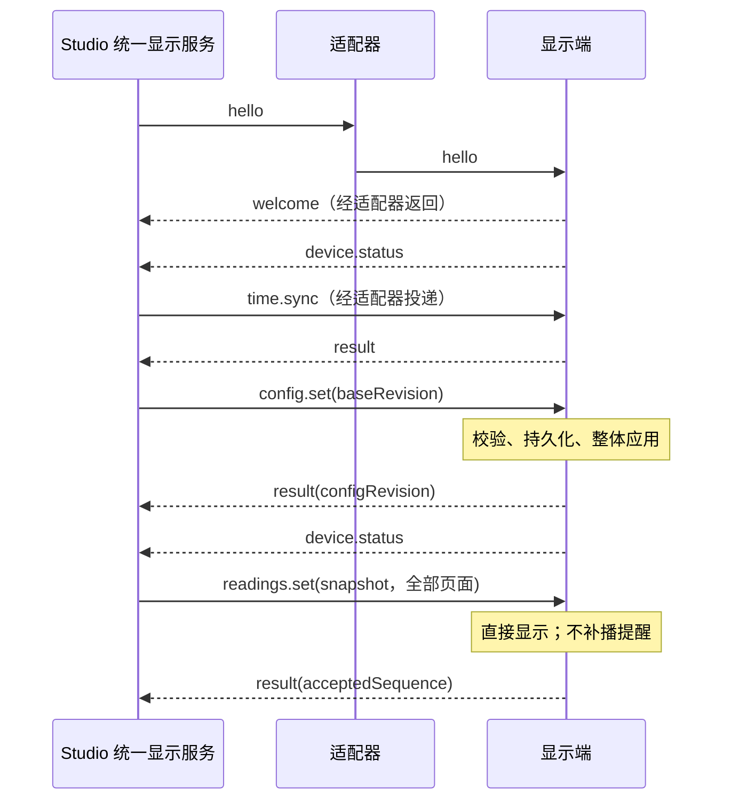
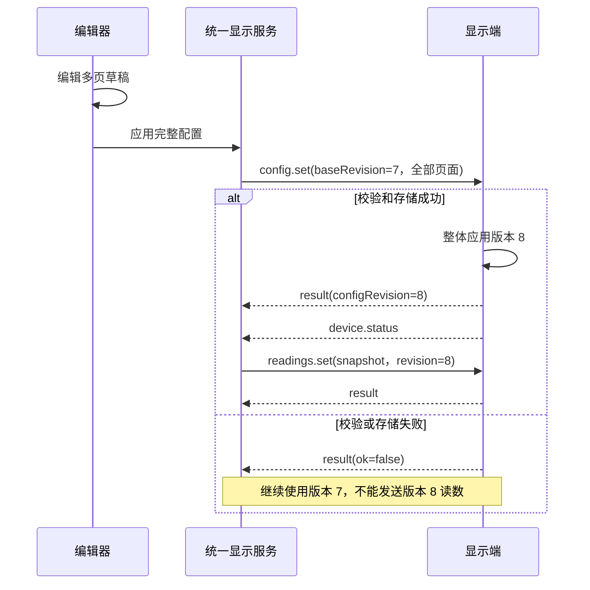
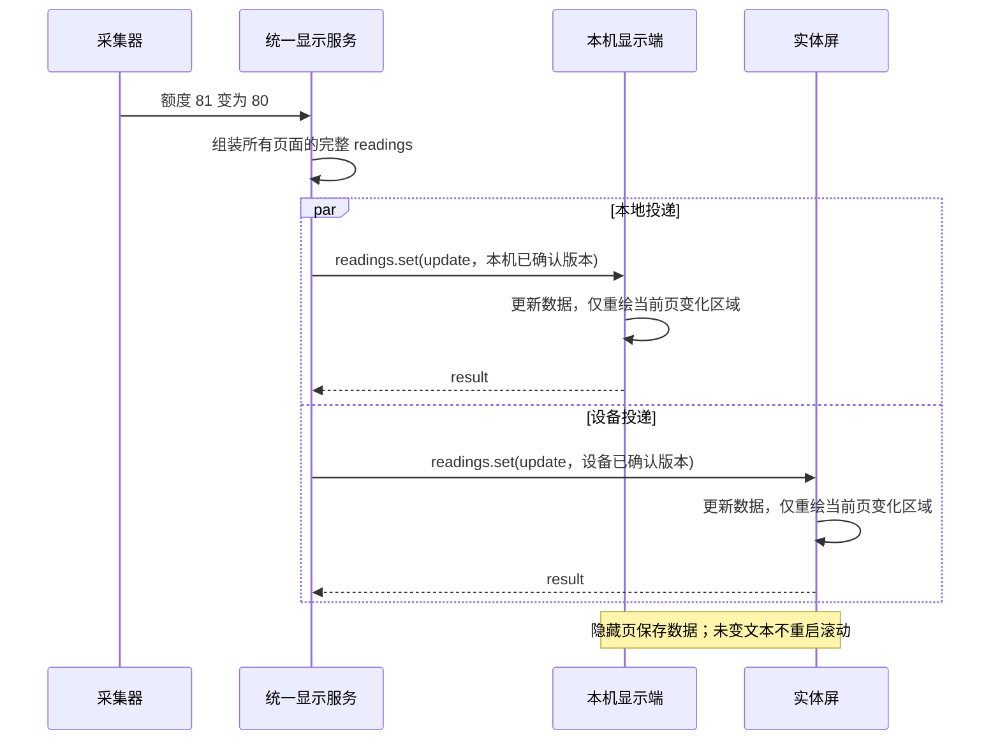
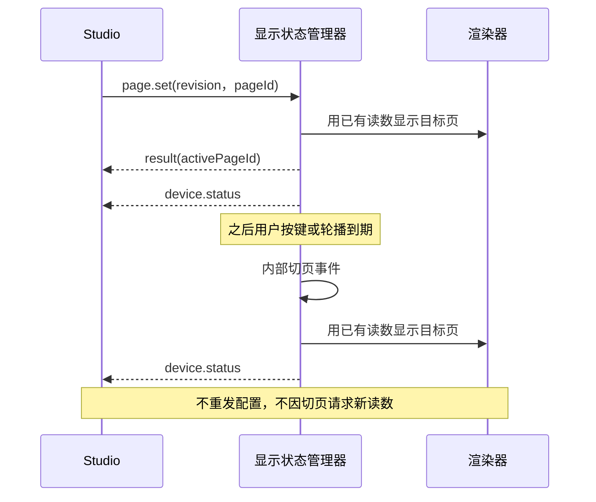
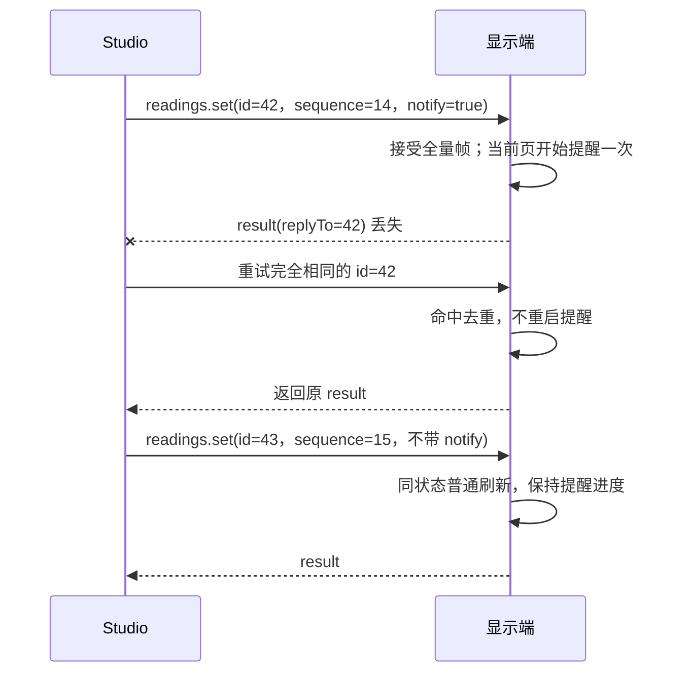
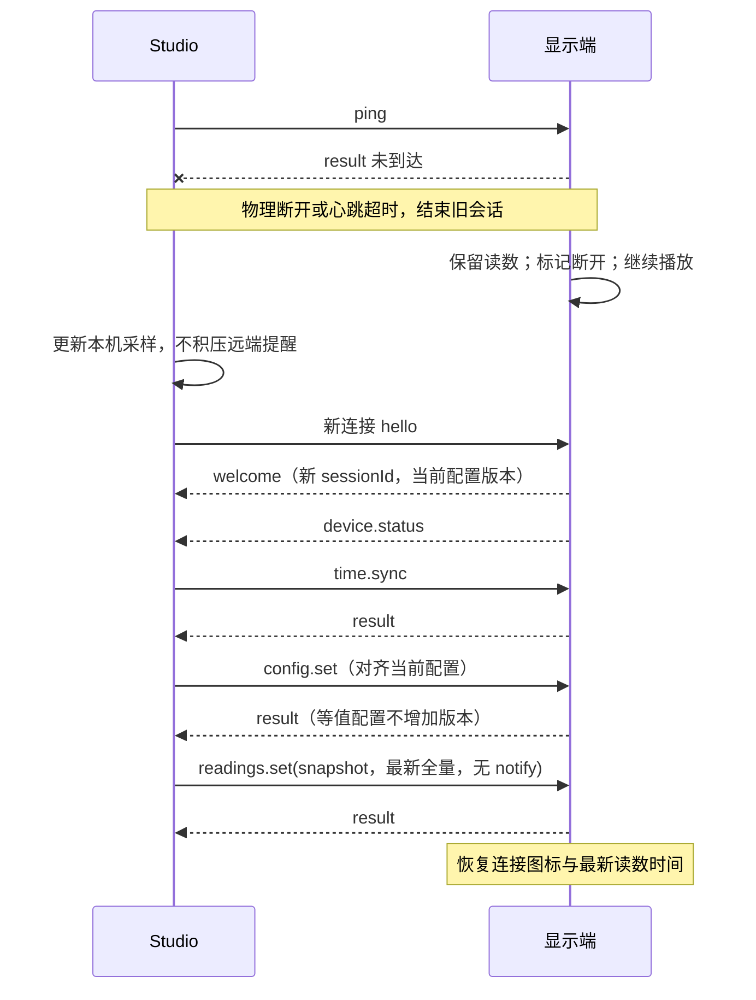
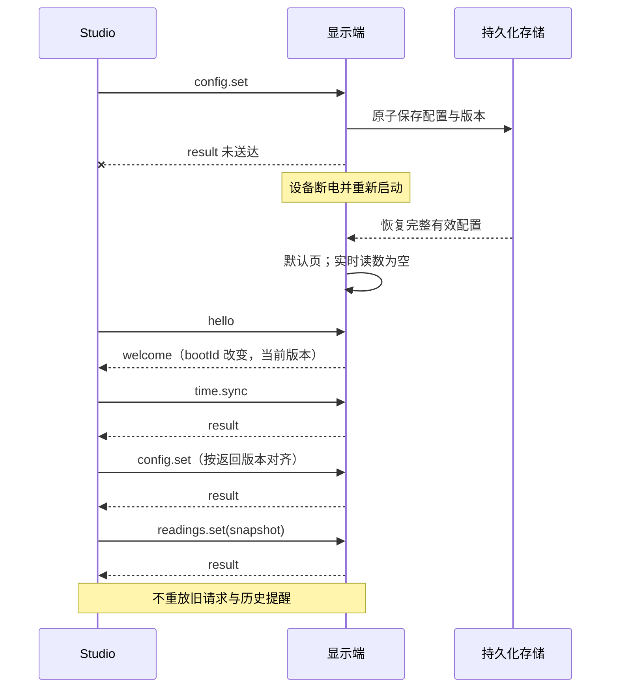
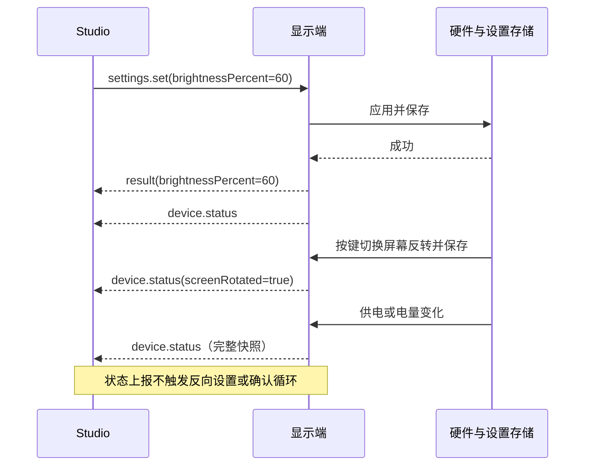

# Mado 统一显示协议 v1

更新日期：2026-11-11。状态：本地显示投影、USB、macOS BLE 和 Wi-Fi v1 已实现。已确认统一显示消息与适配器架构、配置与读数分离、全页面全量读数和断线保留画面。本文记录实现所需的消息、状态和传输规则。

总架构见[总体设计](design.md)，卡片与读数字段见[数据模型](display-config-model.md)，视觉与动画见[UI 规范](display-ui.md)。以下“显示端”同时指本机桌面控件和实体设备。

## 统一机制与适配器

Studio 统一显示服务将业务样本与配置解析为同一套消息。本地适配器投递给本机显示状态管理器，USB/Wi-Fi/BLE 适配器投递给设备接收端。React 与 LVGL 消费同样的显示状态与事件语义。

| 层 | 允许的行为 | 不允许的行为 |
| --- | --- | --- |
| 统一显示服务 | 组装配置和读数；管理每个目标的版本、序列、连接状态和待发送数据 | 按本地/USB/Wi-Fi/BLE 生成不同业务含义的读数 |
| 适配器 | 建连、序列化、分帧、投递、断线报告 | 改值、改单位、改类型、重新决定动画和业务计算 |
| 显示状态管理器 | 校验、去重、存储、原子应用、播放状态管理 | 接收不匹配配置的读数或重复执行请求 |
| 渲染器 | 按统一规范格式化和绘制 | 依赖具体传输通道决定视觉行为 |

消息统一，不要求所有通道都经过网络字节流。本地适配器可直接传对象并内部完成握手与确认，但仍执行相同校验和状态转换。编辑草稿使用同一配置模型与渲染规则，不向正式显示端发送每次拖动；“应用布局”才提交完整配置。

每个目标独立拥有 `configRevision`。同一内容在桌面端可能为版本 8，在设备端为版本 3；统一服务为各目标填入已确认版本及会话字段，`render` 与 `readings` 的含义不变。同一硬件按 `deviceId` 识别，USB/Wi-Fi/BLE 切换建立新会话，v1 不允许两个通道同时控制同一目标。目标间不做分布式事务，一个离线不阻塞另一个。

## 完整消息列表

| 消息 | 方向 | 触发与用途 | 应答 | 持久化影响 |
| --- | --- | --- | --- | --- |
| `hello` | Studio → 显示端 | 每次新连接建立会话与协商版本 | `welcome`，失败 `result` | 无 |
| `welcome` | 显示端 → Studio | 返回身份、能力、会话及当前配置版本 | 无 | 无 |
| `config.set` | Studio → 显示端 | 提交所有页面、布局、主题与播放配置 | `result` | 成功配置及版本 |
| `readings.set` | Studio → 显示端 | 所有页面所有卡片的最新完整读数 | `result` | 无 |
| `page.set` | Studio → 显示端 | 切到指定页面 | `result`，变化时 `device.status` | v1 不要求写 Flash |
| `settings.set` | Studio → 显示端 | 更新受支持的设备设置，例如背光亮度或屏幕反转 | `result`，变化时 `device.status` | 成功设置 |
| `time.sync` | Studio → 显示端 | 同步时间与显示时区偏移 | `result` | 无 |
| `ping` | Studio → 显示端 | 确认链路及接收端仍可响应 | `result` | 无 |
| `result` | 显示端 → Studio | 请求成功/失败及关联结果 | 无 | 无 |
| `device.status` | 显示端 → Studio | 完整运行状态快照 | 无 | 无 |

没有单独的页数事件、增删卡片事件、单卡增量读数事件或动画逐帧事件。页数是 `pages.length`，页面顺序是数组顺序。`notify` 是 `readings.set` 内的一次性提醒事件，不是持久状态。

按键和轮播是显示端内部事件：改变当前页后发送 `device.status`，不冒充 Studio 的 `page.set`。配置/读数失败通过对应 `result` 报告，不新增第二套错误事件。调试日志不属于显示协议。

设备端设置页可以即时预览亮度，确认后保存。屏幕反转切换时直接保存。两项设置分别与 `settings.set` 共用存储，并通过 `device.status` 向 Studio 报告已保存的值。

## 消息外层与基本类型

消息采用 JSON 兼容对象，线缆传输使用 UTF-8 JSON。非负的序列、版本、请求 ID、持续时间和 Unix 毫秒时间戳不超过 `9007199254740991`；业务数值和时区偏移可按各字段契约为负数，整数仍须处于 JavaScript 安全整数范围。颜色为 `#RRGGBB`，数值必须有限，不允许 NaN/Infinity。版本不兼容不得静默降级渲染。

```json
{
  "protocolVersion": 1,
  "sessionId": "session-example",
  "id": 42,
  "type": "readings.set",
  "payload": {
    "configRevision": 8,
    "sequence": 14,
    "mode": "update",
    "readings": {
      "quota-card": { "kind": "progress", "value": 80, "ratio": 0.8 }
    }
  }
}
```

| 外层字段 | 规则 |
| --- | --- |
| `protocolVersion` | 当前为整数 `1`；首次握手也使用 v1 外层，协商失败明确报错 |
| `sessionId` | 显示端分配的不透明字符串；首次 `hello` 及握手失败的 `result` 为 `null` |
| `id` | 正整数；双方各自维护发送方向内递增编号；请求重试保持原编号与内容 |
| `type` | 上表中的消息类型 |
| `payload` | 对应类型的对象 |

本版将讨论草案中的字符串请求 ID 收敛为递增整数，以便有界去重缓存淘汰后仍拒绝旧请求。每条连接的 `hello` 从 `id=1` 开始；会话建立后的 Studio 请求从 2 继续。接收端发送编号独立递增，`replyTo` 引用的是请求方向的 `id`。

| 标识 | 生命周期与用途 |
| --- | --- |
| `deviceId` | 稳定显示目标身份；本机也是一个逻辑目标 |
| `bootId` | 设备重启或本机显示状态服务重建时变化 |
| `sessionId` | 每次新连接变化，隔离旧连接消息 |
| `configRevision` | 目标持久化配置版本；初始为 0，无配置；成功改变内容时加 1 |
| `sequence` | 本会话中读数帧递增序列，从 1 开始，切页或换配置不重置 |
| `statusSequence` | 本会话中状态上报递增序列，从 1 开始 |

消息 ID、配置版本与读数序列各司其职，不能相互替代。达到整数上限前需要受控迁移或新会话，禁止环绕。

## 握手与能力

### hello

`payload` 必填 `supportedProtocolVersions: integer[]` 和 `appVersion: string`。USB 客户端在每次新连接生成可选的 `clientNonce: string`，同一次握手重试沿用原值。

```json
{ "supportedProtocolVersions": [1], "appVersion": "0.1.0", "clientNonce": "connection-uuid" }
```

握手只在新连接接受。相同连接上的同一 `hello` 重试返回原 `welcome`，不得生成第二个会话。活动会话中的新握手请求不能抢占现有控制者；切换通道需先结束旧会话或等其过期。

### welcome

外层 `sessionId` 为新会话；`payload` 如下，示例值代表目标能力形状，不代表现有固件已支持这些能力。

```json
{
  "replyTo": 1,
  "deviceId": "mado-example",
  "bootId": "boot-example",
  "firmwareVersion": "0.1.0",
  "profileId": "tdisplay-c5-v1",
  "configRevision": 7,
  "capabilities": {
    "maxPages": 5,
    "columns": 4,
    "rows": 2,
    "supportedSpans": [{ "w": 1, "h": 1 }],
    "kinds": ["metric", "progress", "state", "chart", "trend", "range"],
    "numberAnimations": ["none", "count"],
    "settings": ["brightnessPercent", "screenRotated"]
  }
}
```

上述字段均必填，`firmwareVersion` 在本机为 `null`，本机版本另由状态中的 `appVersion` 提供。能力必须是该版本实际实现的集合；组件定义支持的规格还需与 `supportedSpans` 取交集。USB 固件同时报告 `maxMessageBytes`、`maxDetailBytes` 与 `maxChartPoints`。

握手成功后主动发送一次 `device.status`。若协议或屏幕 profile 不兼容，停止配置同步，不能只忽略不认识的卡片。

## 配置事件 config.set

`payload` 为 `{ baseRevision, config }`。`baseRevision` 是目标当前已确认版本，`config` 是完整 `DeviceDisplayConfig`。

```json
{
  "baseRevision": 7,
  "config": {
    "schemaVersion": 1,
    "profileId": "tdisplay-c5-v1",
    "theme": {
      "active": "dark",
      "dark": { "background": "#1E1E1E", "surface": "#4A4A4A", "text": "#F1F1F1" },
      "light": { "background": "#E3E3E3", "surface": "#FAFAFA", "text": "#242424" }
    },
    "playback": { "defaultPageId": "codex", "rotationSeconds": 0 },
    "pages": [
      {
        "pageId": "codex", "name": "Codex",
        "cards": [
          {
            "cardId": "quota-card", "x": 0, "y": 0, "w": 1, "h": 1,
            "render": { "kind": "progress", "label": "额度", "unit": "%", "numberFormat": "compact", "numberAnimation": "count" }
          }
        ]
      },
      {
        "pageId": "system", "name": "系统",
        "cards": [
          {
            "cardId": "cpu-card", "x": 0, "y": 0, "w": 1, "h": 1,
            "render": { "kind": "metric", "format": "number", "label": "CPU", "unit": "%", "numberAnimation": "count" }
          }
        ]
      }
    ]
  }
}
```

`playback` 必填：`defaultPageId` 必须属于页面列表；`rotationSeconds` 为 0、5、10、15、30、60，0 表示关闭轮播。页面 1–5 个、每页 4×2，允许空页；坐标、跨格、状态样式等字段见[数据模型](display-config-model.md#屏幕配置与设备协议)。`render` 不包含数据源凭据、脚本或采集接口。

处理顺序：先查请求去重，再检查 `baseRevision`、结构、能力、卡片唯一性和位置，准备完整新配置，持久化配置与新版本，然后整体替换运行配置并确认。中途失败保持旧配置，不能先更新部分页面再报告失败。读取相同结构与规范化默认值后的内容相同，则不加版本、不重复写 Flash；对象键顺序不影响相等，页面/卡片数组顺序按契约保留。

配置确认后成功结果为 `{ configRevision, changed }`。原请求重试返回原结果，不重新比较旧 `baseRevision`。新请求带过期版本则明确拒绝；即使内容恰好相同也不绕过版本检查。

当前页仍存在时保留，否则切到默认页。删除或 `render` 改变的卡片清除旧读数与播放状态；仅位置变化且渲染定义未变的卡片可保留读数。等待新快照时，新卡片显示空态。配置生效后需要一帧 `mode: "snapshot"`，之后才接受正常更新。失败不改变当前运行状态。

## 读数事件 readings.set

`payload` 必填 `configRevision`、`sequence`、`mode`、`readings`。每帧覆盖所有页面、所有卡片，键集合必须与有效配置的 `cardId` 集合完全相等。

```json
{
  "configRevision": 8,
  "sequence": 14,
  "mode": "update",
  "readings": {
    "quota-card": { "kind": "progress", "value": 80, "ratio": 0.8 },
    "cpu-card": { "kind": "metric", "value": 23 }
  }
}
```

该示例匹配上节两页配置。即使只变了额度，仍包含系统页的 CPU。当前无数据时发送 `null`；不允许省略后解释为“沿用旧值”。空页面无需额外键，所有页面为空时 `readings` 为 `{}`。整数 0 是正常值。

| kind | 非空读数形状 | 配置提供的信息 |
| --- | --- | --- |
| `metric` 数值 | `{ kind, value, details? }` | `format: "number"`、单位、数值格式和动画 |
| `metric` 倒计时 | `{ kind, deadlineUnixMs, details? }` | `format: "countdown"`、到期文案 |
| `progress` | `{ kind, value, ratio, details? }` | 单位、数值格式、动画和强调色 |
| `state` | `{ kind, state, detail?, notify?, details? }` | 状态标签、是否支持提醒、状态样式 |
| `chart` | `{ kind, windowEndUnixMs, values }` | 样本数、时间范围、绘图上下限和单位 |
| `trend` | `{ kind, value, delta, details? }` | 比较周期、差值单位和动画 |
| `range` | `{ kind, value, bounds?, details? }` | 固定/动态范围及动画 |

字段类型、默认值与范围由[各 kind 字段](display-config-model.md#各-kind-字段)定义；未列出的业务字段不能混入该类型。图表点数必须符合配置。整帧先校验再应用，未知/缺失卡片、类型不匹配或非法值导致整帧失败，旧读数保留。

### 快照与更新

- `snapshot`：新会话或配置成功应用后的首帧；恢复当前值，不补播数值过渡或旧提醒。禁止携带 `notify: true`。
- `update`：后续正常更新，可触发数值过渡及显式提醒。不因全量帧重建页面，不重启相同文本的滚动。
- 会话或新配置尚无快照时收到 `update` 返回 `SNAPSHOT_REQUIRED`；正常更新阶段再次发快照返回 `INVALID_STATE`，避免不经意打断播放。
- 版本必须相同；新请求的 `sequence` 必须大于最后接受值，允许跳号。相同请求 ID 的重试走去重；使用新 ID 重发旧序列返回 `STALE_SEQUENCE`。
- 成功结果为 `{ configRevision, acceptedSequence }`，表示数据已接受，不表示动画播放完毕。

全量传输不等于全量重绘。隐藏页保存最新读数，切页直接呈现，不另向 Studio 请求数据。相同值不重启动画；动画途中收到新值，从当前显示值向新值过渡。

### 提醒事件

`state` 读数中的 `notify: true` 请求本次提醒；后续帧和重连快照必须去掉该请求。相同状态也可再次请求，但需要新的请求 ID 和帧序列。普通同状态刷新保持提醒进度；状态改变而没有新提醒时结束旧提醒。时长 0 直接显示。

提醒仅对当前显示页播放，不自动切页，也不缓存到未来切页时补播。离开页面结束该页提醒。断线时已开始的提醒可自然结束，断线期间新发生的提醒不排队补发。

Studio 可以合并尚未发送的普通读数帧，只保留最新值，避免慢通道无限排队。尚未投递的提醒须显式管理：同一卡片同状态的待发送提醒可合并为一次；状态被更新覆盖时丢弃过期提醒；不能把一个已发送但确认未知的提醒附着到新帧再次发送。确认未知时只重试原请求，或结束会话后恢复无提醒快照。

## 页面 设置 时间与心跳

| 消息 | payload | 成功 result.data | 规则 |
| --- | --- | --- | --- |
| `page.set` | `{ configRevision, pageId }` | `{ configRevision, activePageId }` | 校验版本和页面存在；目标是绝对页 ID；切页重置轮播计时，不改配置版本 |
| `settings.set` | `{ brightnessPercent }` 或 `{ screenRotated }` | 所提交字段及其已保存值 | 每次只提交一项。亮度为 0–100 整数，反转为布尔值，`true` 表示旋转 180°。只允许能力声明支持的设置，相同值不重复写 Flash。 |
| `time.sync` | `{ unixMs, utcOffsetMinutes }` | `{ clockSynced: true }` | Unix 毫秒与 -840..840 的整数偏移；用于墙上时钟和本地时间显示 |
| `ping` | `{}` | `{ uptimeMs }` | 不改变布局、读数或播放状态 |

Studio 根据 `welcome.capabilities.settings` 决定可用设置。旧固件未声明 `screenRotated` 时，Studio 隐藏反转入口。本机适配器无这些实体屏设置时，`settings` 为空数组。设备设置只有成功提交才更新持久化值，执行失败报告错误并保留旧值。

按键、轮播与 `page.set` 使用同一切页状态转换。重复设置当前页不重建画面，明确的切页操作重置轮播计时；请求重试不再次重置。桌面悬停暂停等本地交互属于本地播放状态，不向其他目标广播。v1 不增加远程临时暂停消息。

首次读数前校时；长连接期间周期校时，并在系统时间/时区变化后校时。动画、轮播、超时和相对运行时间使用单调时钟，不随校时跳变。断线期间继续按最后校准的时钟倒计时；设备重启且未校时时，倒计时显示空态。此校时精度用于秒级 UI，精密时间同步不属于 v1。

心跳设计初值为每 5 秒一次，15 秒没有有效应答则断开；有效结果和状态上报也可证明连接存活，但不代替某次请求的成功确认。显示端同样在 15 秒未收到有效会话请求后结束会话。物理断开可立即结束，无需等待心跳。实际阈值随传输验证冻结。

## result 与 device.status

### 请求结果

成功与失败的 `payload` 是互斥结构：

```json
{
  "replyTo": 42,
  "ok": true,
  "data": { "configRevision": 8, "acceptedSequence": 14 }
}
```

```json
{
  "replyTo": 42,
  "ok": false,
  "error": {
    "code": "CONFIG_REVISION_MISMATCH",
    "message": "读数对应的配置版本与显示端不一致",
    "details": { "expectedRevision": 8, "receivedRevision": 7 }
  }
}
```

`replyTo`、`ok` 及对应分支均必填；`error.details` 可省略。`message` 用于说明，Studio 按 `code` 判断流程，不解析文案。

| 错误码 | 含义与处理 |
| --- | --- |
| `UNSUPPORTED_PROTOCOL` | 无共同协议版本，停止同步 |
| `INVALID_SESSION` | 会话失效，重新连接握手 |
| `SESSION_BUSY` | 已有控制会话，不能自动抢占 |
| `CONFIG_REVISION_MISMATCH` | 版本不一致，恢复握手/版本对齐，停止旧帧 |
| `INVALID_PAYLOAD` | 字段、类型、范围或卡片集合非法，修正内容 |
| `UNSUPPORTED_CAPABILITY` | 不支持 profile、类型、规格、动画或设置，修改目标配置或升级 |
| `PAGE_NOT_FOUND` | 目标页不存在，检查配置 |
| `STALE_SEQUENCE` | 旧读数帧，不应用，继续最新帧 |
| `SNAPSHOT_REQUIRED` | 先发当前配置的完整快照 |
| `INVALID_STATE` | 当前阶段不接受此操作，例如非恢复阶段快照 |
| `DUPLICATE_EXPIRED` | 请求太旧且结果已淘汰，不重新执行，重新同步状态 |
| `REQUEST_ID_REUSED` | 同一 ID 使用了不同内容，协议错误，结束会话 |
| `MESSAGE_TOO_LARGE` | 超过上限，不应用，修正配置/数据 |
| `STORAGE_FAILED` | 配置或设置持久化失败，保留旧有效状态 |
| `BUSY` | 尚未执行，请稍后以新请求重试 |
| `INTERNAL_ERROR` | 未能完成操作，报告失败并重新核对目标状态 |

无法解析出请求 ID 的传输垃圾不能构造可靠的 `replyTo`；由适配器丢弃或关闭连接，并报告本地连接错误。调试文字不能混进协议帧。

### 完整状态上报

```json
{
  "statusSequence": 25,
  "configRevision": 8,
  "activePageId": "system",
  "brightnessPercent": 60,
  "screenRotated": false,
  "transport": "usb",
  "appVersion": null,
  "power": { "source": "external", "batteryPercent": null, "charging": false },
  "clockSynced": true,
  "uptimeMs": 180000,
  "lastConfigAppliedAtUnixMs": 1794280800000,
  "lastReadingsAppliedAtUnixMs": 1794280805000
}
```

`activePageId` 在无配置时为 `null`。声明支持屏幕反转的设备上报布尔值 `screenRotated`，旧固件可缺省。不适用的亮度、App 版本、电量、充电状态或未知绝对时间为 `null`。`transport` 为 `local / usb / wifi / ble`。`power.source` 为 `external / battery / unknown`，电量为 0–100 整数或 `null`，充电为布尔值或 `null`。本机不得把电脑电池冒充实体屏电池，可使用 `unknown`。

握手后、配置/切页/设置成功及供电变化时上报，并周期补发完整状态。时间戳分别表示配置与读数的成功应用时间，不能以收到 ping 的时间更新；未校时为 `null`。设备界面 `Updated at` 使用最后读数时间。`statusSequence` 用于丢弃旧上报；状态消息不反向触发同名设置请求。

断开时显示端无法通过已断的通道上报“断开”。Studio 由适配器/心跳判断，设备由物理连接/心跳判断；两端都保留最后成功读数时间。

## 确认 重试与故障隔离

- v1 每个目标最多一个未完成的 Studio 请求，按顺序投递；状态上报可异步到达。普通读数可在待发送区合并，配置不能被后来的旧读数越过。
- 设计初值：请求 3 秒未应答，使用相同 ID 和完全相同内容最多重试两次；仍无结果则标记结果未知、结束会话并重新同步。不能把超时直接解释为“设备未执行”。
- 接收端保存本会话的请求 ID 高水位及最近结果。查去重在业务校验之前；处理中重复请求不再次执行，完成后返回原结果。缓存保存请求内容指纹，识别 ID 重用。
- 已处理 ID 的结果被有界缓存淘汰后，靠高水位拒绝旧 ID 并返回 `DUPLICATE_EXPIRED`，不能再次执行。缓存容量与消息上限一起验证。
- 明确的失败结果同样是该请求的终态；修正内容或稍后重试业务操作时使用新 ID。传输超时重试才保持旧 ID。
- 重连不携带旧会话的待重试请求。配置重新按当前版本提交，等值配置不重复写入；读数以无提醒快照恢复。
- `configRevision` 与配置必须原子持久化。断电后只恢复完整的旧或新配置；应用成功但确认丢失时，重新握手读取版本并对齐。

## 事件时序图

图中的适配器代表任一投递方式，本地适配器同样遵循这些语义。实线消息名称与完整列表一致；内部操作用说明标注。

### 首次连接与初始显示



### 页面增删 排序或布局修改



### 单项变化仍发送全页面全量读数



### App 切页 按键与轮播



### 提醒与确认丢失重试



### 断线 保留画面与重连



### 设备重启与配置确认未知



### 设置与设备主动上报



## USB、BLE 与 Wi-Fi 传输

USB 使用 USB Serial/JTAG 的串口，Studio 识别 VID/PID `303A:1001`。每条消息是紧凑 UTF-8 JSON，以 LF 结束。接收端累积半包、按换行切分粘包；空行是重新对齐的分隔符。超过 65536 字节或含非法帧内容时丢弃该行。业务日志使用独立 UART。消息只有完整解析并校验后才应用。

Studio 推送间隔默认 1000 ms，可设置 500–60000 ms。一次只发送一个等待确认的请求，3 秒超时重试相同帧，最多重试两次。心跳每 5 秒，设备 15 秒无有效请求时断开旧会话。每个图表最多 12 点，详情单字段最多 1024 UTF-8 字节。Studio 预留外层消息空间；读数总大小逼近上限时缩短可选文本，保留全部卡片和值。超出上限的配置不能提交到设备。

BLE 使用私有 GATT 服务 `4e780001-704f-4fd7-a0dc-2c0fad1e48ad`。同一 UUID 基础下，`0002` 为带响应的写入，`0003` 为返回字节流通知，`0004` 为受保护的两字节小端 ATT MTU。Studio 读取 MTU 触发系统配对，订阅通知后建立协议会话。字节流沿用 UTF-8 JSON 和 LF 分帧，按协商的 ATT MTU 减三分片，完整帧才交给协议层。固件要求经过验证的加密与绑定后才接受写入；绑定保存在设备 NVS。BLE 在每次读数确认后至少间隔两秒，传输中的大帧会保持当前会话活动。

固件将会话绑定至握手通道；其他通道的握手收到 `SESSION_BUSY`。BLE 或 Wi-Fi 断开时释放会话。Studio 正常关闭 USB 时发送 `session.close`（空对象），设备确认后释放会话；旧固件仍按心跳超时释放。通道切换保留最后画面。

Wi-Fi 在设备取得 IPv4 地址后公布 `_mado._tcp.local.`，使用 TCP 端口 `47861`，TXT 记录 `id` 对应协议中的 `deviceId`。Studio 通过发现结果或手填 IP 建立双向 TLS。每次配网生成独立 CA 和两份证书，Studio 校验服务端证书和 `welcome.deviceId`，设备校验 Studio 的客户端证书。mDNS 仅提供地址。TLS 内沿用相同的 UTF-8 JSON 与 LF 分帧。

设备声明 `capabilities.wifiProvisioning` 后，当前 USB 或已认证 BLE 会话可发送 `wifi.provision`，包含 `requestId`、`ssid`、`password`、`ca`、`certificate` 和 `key`。证书和私钥使用 PEM。设备在后台入网，返回 `joining` 后由 Studio 轮询 `wifi.status`。取得地址并保存后返回 `ready` 和 `address`；失败返回 `failed` 和错误码，并恢复以前保存的网络。状态还返回 `savedProfileId`，用于在配网期间断线后识别设备已保存的身份。Studio 确认局域网可达后关闭当前会话，再建立 Wi-Fi 会话。固件烧录、字库更新和调试日志使用专门的通道。

## 契约验收

使用同一组配置、读数和事件序列验证本机与设备：全量帧缺键拒绝、零值有效、未知能力拒绝、旧版本隔离、提醒只执行一次、状态更新不重启同文本滚动、切页不请求数据、断线保留和重连快照、配置确认丢失后不重复写入、缓存淘汰后旧请求不重执行。两端分别检查像素布局、字号和动画节奏；传输适配器通过半包、重试、断连与上限测试。
