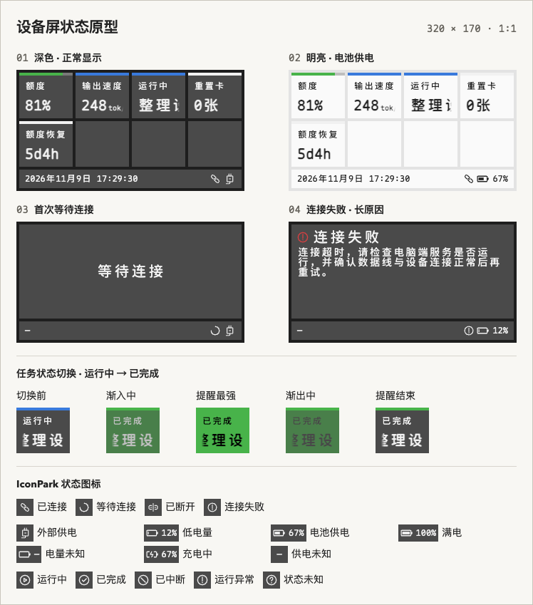
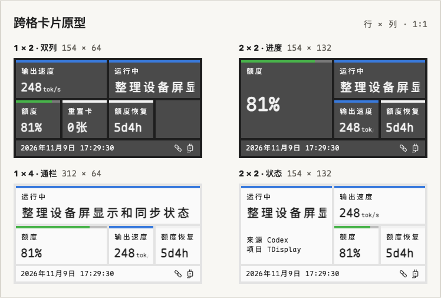

# TDisplay 设备屏 UI 设计规范

这份草案以新版 320 × 170 横屏稿为基准，适用于实体屏、App 内的原尺寸预览和独立桌面控件。下文尺寸均为设备像素。App 的窗口、组件库和编辑控件使用 ReUI v1 与统一的浅深色语义变量，正文采用系统无衬线字体；下文设备像素字体仅用于画布、缩略图和桌面控件。

「设置 → 外观」提供 App 浅色／深色／跟随系统，以及独立的桌面控件深色／浅色主题。预览、缩略图与桌面控件同步改变，自动保存并在重启后恢复。

主题、布局和实时读数的协议提案见 [屏幕配置数据模型](display-config-model.md)。

桌面控件直接读取本机数据，不依赖硬件连接，首次打开即显示默认或已应用布局。「应用布局」提交编辑器草稿；实时读数持续更新。桌面状态栏保留相同排版，将固件版本替换为 `App v版本号`，右侧改为显示器图标和「本机」标识。下文的等待连接、等待同步、连接失败和供电状态仅适用于实体设备模式。

桌面控件默认置顶，可以取消并记住选择。无边框窗口可拖动，悬停或键盘聚焦时显示编辑布局、置顶切换、关闭三个操作；这些操作属于桌面叠层，不进入设备画布。关闭主窗口后控件继续显示，控件上的编辑入口可以重新打开主窗口。

## 原型图

[打开交互原型](display-ui-prototype.html)。用「当前页」在「Codex 软件」和「系统」之间切换，用「连接方式」试看 Wi-Fi、蓝牙和 USB 图标。「Codex 软件」页可以用「布局示例」切换卡片规格、修改对话标题和试播提醒。系统页展示 CPU 占用、趋势和区间。「连接失败」场景可编辑原因，试看超长文本。原型使用模拟数据。

## 画布与网格

| 区域 | 尺寸 | 位置与间距 |
| --- | --- | --- |
| 屏幕 | 320 × 170 | 四边留 4 px |
| 内容区 | 312 × 132 | 原点 (4, 4)，4 列 × 2 行，横纵间距 4 px |
| 基础格子 | 75 × 64 | 列起点为 4、83、162、241，行起点为 4、72 |
| Status Bar | 312 × 26 | 原点 (4, 140)，与内容区间隔 4 px |

屏幕、卡片、状态栏均使用直角。卡片无描边、无阴影。空格使用卡片底色，保持空白。等待连接、等待同步和首次连接失败时，一块 312 × 132 的面板替换内容区，状态栏留在原位。

拖拽、移除、选中和落点提示属于 App 编辑叠层。组件库的缩略图使用同一个 1 × 1 渲染结果等比缩小。

### 卡片规格

界面按「行 × 列」标注规格。布局数据沿用 `w` 表示列数、`h` 表示行数。例如 1 × 4 对应 `w=4, h=1`。每张卡片绑定一个组件实例。跨格时扩大该组件的显示面积，内部间距并入卡片，外部与邻格仍隔 4 px。

| 规格 | 占用 | 卡片宽 × 高 | 文字区宽 | 排版 |
| --- | --- | --- | --- | --- |
| 1 × 1 | 1 格 | 75 × 64 | 59 px | 基础标签和读数。 |
| 1 × 2 | 2 格 | 154 × 64 | 138 px | 沿用基础字阶和纵向位置，增加读数、单位和状态详情的可读长度。 |
| 2 × 2 | 4 格 | 154 × 132 | 138 px | 指标和进度读数放大到 32 px，状态详情保持 20 px。下方可显示最多两行辅助信息。 |
| 1 × 4 | 4 格 | 312 × 64 | 296 px | 通栏横跨一整行，沿用基础字阶。优先用于长标题和长读数。 |

所有组件提供 1 × 1。组件定义声明额外支持的规格，编辑器只展示这些选项。改变规格时，以当前左上格为锚点，超出边界或与相邻卡片重叠时保留原规格。1 × 4 从第一列起放，2 × 2 从第一行起放。占用格数按行数乘列数统计。状态栏固定在网格下方。

## 组件类型

布局记录组件实例、格子坐标和占用规格。数据源负责提供标签、读数、单位、状态等内容，渲染器按组件类型和规格排版。

| 类型 | 内容 | 显示规则 |
| --- | --- | --- |
| 指标 `metric` | 标签、读数、可选单位 | 固定两行：第一行标签；第二行左侧为数值，右侧为固定宽度的单位区，Value 与单位固定间隔 2 px。单位区按可用宽度自动折行，最多两行，始终保留在读数行。数值按量级缩写，最多显示 4 个字符；4 字符时字号为 17 px，其他数值为 20 px。普通小数尽量保留，必要时按格式精度取舍。数值行不滚动，卡片宽度不变。1 × 1 内容区宽度固定为 59 px。倒计时是指标的一种格式，由数据源提供截止时间和到期文案。 |
| 进度 `progress` | 指标内容及 0–1 的进度比例 | 顶部填充宽度为 `round(卡片宽度 × 进度比例)`。0 只显示底轨，1 填满，缺失时保留空底轨。 |
| 状态 `state` | 状态标识、状态标签、详情文字 | 上方显示状态标签，下方显示详情。支持提醒的组件可以按状态配置颜色和时长。 |
| 趋势 `trend` | 当前值、相对上一周期的有符号变化量 | 与指标、进度共用读数行。20 px 当前值、单位和 8 px 变化 tag 沿同一底边对齐，tag 右侧距卡片边缘 8 px。箭头由差值计算，上涨用绿底，下降用红底，持平用普通主题字色作底色。原型示例为 CPU 占用及相对上一周期的变化。 |
| 区间 `range` | 当前值、固定或动态上下限 | 显示当前值和带刻度的范围轨道，标记当前值在范围中的位置。轨道距卡片左右和底边均为 8 px，数值行在轨道上方。原型示例为 0–100% CPU 区间。 |
| 图表 `chart` | 标题、离散采样点 | 1 × 1 显示 12 列柱状图，每列最多 7 格。单块 4 × 3 px，横纵间距均为 1 px。绘图区高 27 px，左右和底边各留 8 px。最新值 tag 用 8 px 字号，悬浮在绘图区左上角，可盖住左侧柱体。柱体和 tag 底色使用普通主题字色，tag 文字使用屏幕背景色。时间范围、单位和上下限保存在组件定义中。原型示例为 CPU 占用。 |

数值变化动画支持逐位滚动和计数动画两种。逐位滚动只移动变化的数位；计数动画按数值方向经过中间值，例如 `80 → 90` 显示 `81…90`，大跨度变化在不超过 800 ms 内插值更新。原型可设置 Start、End 并切换动画方式，在同一个 1 × 1 模块中试播。

新数据源只要能映射到这些字段，就能复用卡片排版、滚动和提醒逻辑。例如「剩余额度」和「下载进度」都可以使用进度类型。「Codex 任务」和「构建任务」都可以使用状态类型。

交互稿把 CPU 图表、趋势和区间作为三张 1 × 1 卡片放在「系统」页。趋势显示相对上一周期的差值，CPU 百分比的差值用百分点。图表中缺数据的列留空。定义与读数结构见[屏幕配置数据模型](display-config-model.md#图表趋势与区间)。

## 可配置外观

App 的「设置 → 屏幕外观」配置设备主题。深色和明亮主题分别保存屏幕背景、卡片与状态栏底色、字体色。连接面板和空格跟随卡片底色。下表是主题示例，用户可自定义。

| 用途 | 深色 | 明亮 |
| --- | --- | --- |
| 屏幕背景、外边距与格间距 | `#1E1E1E` | `#E3E3E3` |
| 卡片、空格、连接面板、状态栏 | `#4A4A4A` | `#FAFAFA` |
| 正文、读数、单位和常态图标 | `#F1F1F1` | `#242424` |

### 组件状态颜色

- 选中卡片后从「组件设置」进入「状态颜色」。只有支持状态通知的组件提供这组配置。
- 每个状态单独选色。App 提供 10 个预设色和自定义 HEX 输入，深浅主题共用同一组状态映射。导出稿里的颜色只用来举例。
- Codex 任务状态可以分别配置「运行中」「已完成」「已中断」「运行异常」「状态未知」。数据源给出状态，设备按配置更新顶部色条和状态标签。状态的颜色由用户选择。
- 未配置的状态回退到卡片的常态标记色。暂无任务显示「任务状态」和「—」。普通数值组件可配置标记色或进度色。
- 设置内可以切换示例状态并播放提醒，在 1 × 1 卡片上即刻查看效果。真实运行时按数据源状态显示。主题、状态颜色与提醒设置先更新编辑器草稿，点击「应用布局」后与布局一起更新桌面控件；实体设备另按同步协议接收配置。

| 预设 | HEX | 预设 | HEX |
| --- | --- | --- | --- |
| 默认 | `#F1F1F1` | 紫 | `#9267CD` |
| 红 | `#D63F41` | 黄 | `#D3AD3E` |
| 绿 | `#48B34A` | 青绿 | `#349E9A` |
| 蓝 | `#397ADC` | 玫粉 | `#C96091` |
| 橙 | `#DE7B3C` | 蓝灰 | `#9BA5B3` |

常态下，状态色用于顶部色条、进度和状态图标，文字使用主题字色。状态同时通过标签或图标形状表达。连接失败面板沿用主题字色，配失败状态标记。额度进度底轨采用主题字色的低透明度色，0% 时保留底轨。

### 状态提醒

每个可通知的状态可设置「闪烁时长」。首稿默认 2 秒，输入范围暂定为 0 至 10 的整数秒，0 表示仅更新状态。每轮持续 1 秒，底色用 420 ms 渐入、580 ms 渐出。字色在每段开始后 120 ms 跟上，与底色同时到达该段终点。两者均采用缓入缓出曲线。

| 阶段 | 4 px 顶部色条 | 卡片底色 | 文字和单位 |
| --- | --- | --- | --- |
| 常态 | 当前状态色 | 主题卡片底色 | 主题字色 |
| 提醒相 | 当前状态色 | 当前状态色 | 提醒字色 |

提醒字色默认自动选用在当前状态色上对比度更高的黑或白，也可在 App 为该状态自定义。状态切换时，顶部色条直接更新为新状态色，并在整个提醒期间保持该颜色。时间到后停在新状态的常态。卡片尺寸、排版和当前文字滚动位置保持连续。

状态标签和色条随读数更新。写入方在本次状态读数中设置 `notify: true` 时，按目标状态的配色和时长播放提醒，时长为 0 时直接显示。新的提醒请求会按最新状态重新计时。同状态的普通刷新保留动画进度，直接切换到另一状态时结束旧提醒。首次加载和重连快照默认直接显示。 [数据模型](display-config-model.md#写入方请求状态提醒)

## 卡片与字体

字体统一为 Maple Mono NF CN。卡片内坐标以卡片左上角为原点，纵坐标对应行盒顶部。字号只适用于设备画布。App 当前随包字体为 400 字重，制作 1:1 样稿时需确认预览和实体屏使用同一套 700 字形。

| 元素 | 位置 | 字号 / 行高 / 字重 |
| --- | --- | --- |
| 顶部状态条或进度条 | (0, 0)，高 4 px，铺满整张卡片 | — |
| 标签 | (8, 12)，两侧各留 8 px | 12 / 14 / 400 |
| 主读数或任务标题 | (8, 36)，两侧各留 8 px | 常规 20 / 20 / 700，2 × 2 指标和进度 32 / 32 / 700 |
| 行内单位 | 紧接读数，间隔 2 px，单位区底边与读数行对齐 | 1 × 1 为 10 / 10 / 400 |
| 2 × 2 辅助信息 | (8, 84) 开始，最多两行 | 12 / 16 / 400 |
| 状态栏时间与固件版本 | 两行，整体垂直居中 | 6 / 6 / 400 |
| 状态栏电量文字 | 高度居中 | 12 / 12 / 400 |
| 连接面板标题 | 等待态居中，失败态距上、左各 8 px | 20 / 20 / 400 |
| 连接失败原因 | 标题下方 296 × 92 px，四周留出面板边距 | 14 / 14 / 400 |

1 × 1 指标、进度、趋势卡共用 20 px 高的读数行，距卡片左右和底边均为 8 px。Value、单位和趋势 tag 的行盒底边对齐。区间卡的轨道占用底部空间，读数放在轨道上方。

标签和读数各占一行。数值和单位一起占用固定宽度的读数区，读数保持静止。单位区按最多 18 px 的宽度自动折行，最多显示两行。短单位占底部一行，例如 `81%`、`0张`。长单位由渲染器分行，例如 `tok/s` 显示为上行 `tok`、下行 `/s`。超出两行时末尾显示省略号。缺少有效值统一显示静态的「—」，真实的零值照常显示。

辅助信息仅使用该组件自身明确提供的字段，例如任务状态的项目名。额度与额度恢复是独立组件，各占自己的格子。2 × 2 卡片没有辅助信息时，读数在标签下方的可用空间内纵向居中。

### Codex 示例

| 示例组件 | 复用类型 | 数据源输出 |
| --- | --- | --- |
| 剩余额度 | 进度 | `81%` 与进度比例 `0.81`。 |
| 输出速度 | 指标 | `248` 与长单位 `tok/s`。 |
| 重置卡 | 指标 | `0` 与短单位「张」。 |
| 额度恢复 | 指标 | `5d4h`、`1h05m`、`12m`、`8s` 等紧凑格式，到期显示「待刷新」。 |
| 任务状态 | 状态 | 当前状态标签与完整对话标题。有任务但无标题时显示「未命名对话」。暂无任务时显示「任务状态」和「—」。 |

## 单行滚动与边缘渐隐

1. 以最终字体、字号、字重和实际字形测量整行。将换行和制表符合并为空格。宽度等于或小于可见区时静止显示，两侧无渐隐。超宽时保持原字号并从右向左循环滚动。
2. 首次显示或切换到新标题时，从行首停留 800 ms，左侧完整可读，右侧渐隐。之后以 32 px/s 匀速移动。连续排两份相同文本，副本之间留 18 px，移动完「文本宽度 + 18 px」时接续下一轮。这三个参数在 1:1 动效稿中确认。
3. 移动期间只给文字所在行做遮罩。左右各 4 px 渐隐，适用于所有规格。每行按本规格的实际文字区宽度单独测量。文字区距卡片两侧仍各为 8 px。
4. 卡片标签、状态详情和辅助文字按各自行宽判断是否滚动。行外的底色、色条和图标保持静止。重复收到同一文本时继续当前位置。数值按读数格式缩写并留在原位。
5. 桌面预览用文字遮罩。实体屏按同一遮罩曲线把文字逐像素混合到卡片当帧底色，再输出 RGB565。状态提醒换色时，渐隐边缘与新底色同步。用 100% 画布观察至少一次完整循环。

## 连接状态与状态栏

| 连接场景 | 内容区 |
| --- | --- |
| 首次等待连接 | 居中显示「等待连接」。 |
| 首次连接失败 | 固定显示「连接失败」，在下方完整排版原因。正文超高时上下滚动。 |
| 已连接，尚未收到布局 | 居中显示「等待同步」。 |
| 已连接并收到布局 | 显示 4 × 2 网格。各组件可独立处于有值或无值状态。空布局显示 8 个空格。 |
| 已有布局，连接断开 | 保留最近画面，状态栏切换断开图标。恢复连接后继续更新。 |

状态栏左右各留 8 px，所有内容垂直居中。页名 Tag 左侧竖排页码圆点，从上到下对应页面顺序，当前页高亮。最多 5 页，原型固定展示 5 个圆点以预览满额效果。圆点直径 2 px，点间距 1 px，与 Tag 间隔 8 px。页名 Tag 使用 10 px 字号，右侧间隔 8 px 排两行 6 px 文字。第一行显示 `Updated at HH:mm:ss`，取最近一次成功同步的时刻，尚无记录时显示 `Updated at —`。第二行显示固件版本，原型示例为 `FW v0.1.0`。右侧依次显示连接和供电状态，两组间隔 4 px。

### 状态图标

统一使用 IconPark 线框图标。以原始 48 × 48 画板为基础，按实际显示尺寸校正轮廓占比、视觉中心和线条轻重。连接组和供电组分别保留 14 px 与 18 px 的布局槽位。供电组略收细描边，插头缩小并居中，电池水平居中。任务图标统一采用圆形轮廓。状态栏图标使用主题字色，优先靠轮廓区分状态。 [IconPark 官方图标库](https://iconpark.oceanengine.com/official) · [IconPark 源码](https://github.com/bytedance/IconPark)

| 位置 | 状态 | IconPark 名称 | 显示方式 |
| --- | --- | --- | --- |
| 状态栏连接 · 14 px | 等待连接、连接中 | `loading-four` | 开口圆环 |
| 状态栏连接 · 14 px | Wi-Fi 已连接 | `wifi` | 无线波纹 |
| 状态栏连接 · 14 px | 蓝牙已连接 | `bluetooth` | 蓝牙标志 |
| 状态栏连接 · 14 px | USB 已连接 | `usb` | USB 三叉标志 |
| 状态栏连接 · 14 px | 已连接、等待同步 | 随连接方式 | 保留对应连接图标，时间行显示 `Updated at —` |
| 状态栏连接 · 14 px | 已断开 | `link-break` | 横向断开的接头 |
| 状态栏连接 · 14 px / 失败面板 · 16 px | 连接失败 | `attention` | 圆形感叹号，面板上与标题同排 |
| 状态栏供电 · 18 px | 外部供电 | `plug-one` | 仅插头图标 |
| 状态栏供电 · 18 px | 电池 0–100% | `battery-empty` | 共用外框，按电量填充内部，并保留百分比 |
| 状态栏供电 · 18 px | 电量未知 | `battery-empty` | 空电池与「—」，和 0% 区分 |
| 状态栏供电 · 18 px | 充电中 | `battery-charge` | 充电图标加百分比。设备提供充电状态时使用，原型用模拟数据 |
| 状态栏供电 | 供电来源未知 | — | 只显示「—」 |

任务状态在 App 配置界面和图例使用 16 px 图标。1 × 1 设备卡片用状态标签与色条，给文字保留 59 px 宽度。

| 任务状态 | IconPark 名称 |
| --- | --- |
| 运行中 | `play` |
| 已完成 | `check-one` |
| 已中断 | `forbid` |
| 运行异常 | `attention` |
| 状态未知 | `help` |

原型内置选用的 SVG，电池填充按模拟电量生成。 [IconPark 许可证](iconpark-license.txt)

### 连接失败原因

正文从面板内的 (8, 32) 开始，保留原有换行，并按 296 px 宽度自动折行。内容高度在 92 px 以内时整段静止显示。更长的内容从顶部向上滚到末尾，再向下返回，两端各停留 800 ms。首稿滚动速度为 20 px/s。

超出视窗的那一端使用 4 px 渐隐。起点只有下沿渐隐，途中上下两侧渐隐，终点只有上沿渐隐。标题和状态栏保持固定。

## 后续出稿核对

| 优先级 | 稿件 | 需要确认的画面 |
| --- | --- | --- |
| P0 | 正常显示，深色和明亮各一张 | 对照「Codex 软件」和「系统」页核对字阶、色条、进度和空格底色。 |
| P0 | 连接流程状态板 | 对照短原因、多行完整显示和超高滚动三种错误正文，再核对首次未同步、连接中、断线后保留画面和重新连上。 |
| P0 | 滚动动效样稿 | 同画板放短标题、长中英文标题和超宽的「数值 + 单位」。提供起始停留、两端渐隐、循环接续三帧，另附一段完整循环。 |
| P0 | App 外观和状态提醒设置 | 一张展示主题设置和 1:1 预览。另一张展示 Codex 任务状态逐项选色、闪烁秒数、提醒字色及试播。补无效输入、0 秒和恢复默认的局部变体。 |
| P0 | 状态切换动效样稿 | 展示「运行中 → 已完成」和「运行中 → 运行异常」。每组给出切换前、渐入中、提醒最强、渐出中和结束五帧。至少一组同时播放超宽标题，检查文字滚动位置和渐隐边缘。 |
| P0 | 状态栏变体条 | 对照原型图例的连接和供电状态，检查未同步时间和最长时间加电量的组合。 |
| P1 | 组件边界状态板 | 额度 0% / 100% / 无数据，速度或重置卡 0 / 无数据，倒计时到期，任务各状态与无标题。用 1 × 1 组件变体统一交付。 |

全屏稿覆盖连接流程和深浅主题。供电与数据边界用局部变体覆盖，滚动和状态提醒用动效样稿验收。
