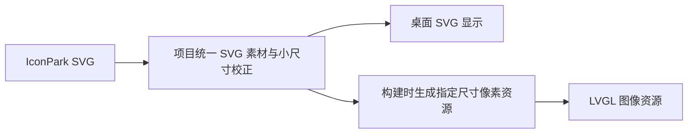

# Mado 固件与显示资源设计

更新日期：2026-11-10。本文维护实体屏、字体、图标及 Flash 的构建与验收说明。总架构见[总体设计](design.md)，通信见[统一显示协议](display-protocol.md)。

## 硬件与渲染

使用 LILYGO T-Display-C5 V1.0，无触控，ESP32-C5、16 MiB Flash、8 MiB PSRAM。ST7789 横屏输出 320×170 RGB565，显示引脚为 CS 26、SCK 7、MOSI 9、DC 8、RST 23、背光 25；I²C SDA 2、SCL 3 连接 AXP2602，INT 10；用户键 0、BOOT 28。引脚与板级约束的维护位置是 [AGENTS.md](../AGENTS.md)。

实体屏使用 ESP-IDF 5.5.5、LVGL 9.2.2、FreeType 2.14.3 与 Brotli 1.1.0。LVGL 使用 RGB565 画布与双 DMA 缓冲，通过 40 MHz SPI 提交每帧的变化矩形。用户键短按进入下一页，Studio 指令和轮播也能切页。

UI 几何与动画以[渲染规范](display-ui.md)为准，不另建固件专用视觉规范。显示状态与绘制解耦；字体加载、资源解码与通信处理不能在每帧重复执行。

## 字体选择与生成

统一使用 **Maple Mono CN Regular**，不包含 NF 图标字体。FreeType 在运行时选择字号，使用 `FT_Outline_Embolden()` 模拟加粗。UI 中的 400/700 是视觉层级，700 对应模拟加粗参数，不代表存储了真实 Bold 字体。具体加粗强度和基线需由两端样稿与实板校准。接口与集成参考：[FreeType 加粗接口](https://freetype.org/freetype2/docs/reference/ft2-outline_processing.html#ft_outline_embolden)、[Espressif FreeType 组件](https://components.espressif.com/components/espressif/freetype)。

桌面与交互原型共用 `src/assets/MapleMono-CN-Regular.woff2`。源文件来自 [Maple Mono v7.9 官方 CN-unhinted 发布包](https://github.com/subframe7536/maple-font/releases/tag/v7.9)中的 `MapleMono-CN-Regular.ttf`，保留 22,731 个源字体码位。字体许可证见 [SIL OFL 1.1](../src-tauri/licenses/maple-mono.txt)。源 TTF 的 SHA-256 为 `0fcc5139bfd5ab14ff989bb7dfd5236d0cafc10e60b9828569e6883613ab4085`，可选的 `--import-ttf` 参数会检查该值。

### WOFF2 分片与缓存

分片用于限制每次打开压缩字体的内存峰值和延迟。FreeType 需要解压并重建 WOFF2 字体数据，再按需栅格化字形；不是每显示一个字就只解压该字。相关实现见 [FreeType WOFF2 源码](https://github.com/freetype/freetype/blob/master/src/sfnt/sfwoff2.c)。

分片数不是产品约束。分片越小，单次解码数据通常越少，但跨片次数、重复字体表开销及缓存置换可能增加；分片越大，单次内存和延迟通常越高。分片方式不得改变字符覆盖和正确的字形度量。

分片 0 收录基础拉丁字符、常用标点、仪表盘和板载设置文案。剩余码位按 Unicode 顺序分组，每组最多 1,024 个。固件以桌面 WOFF2 为输入生成独立子集，移除不参与逐字栅格化的连字和定位表，保留源字体所有映射码位。构建会核对每片 cmap 与索引，并拒绝超出分区容量的镜像。

当前镜像共 23 片，含索引占 6,280,316 字节，距分区上限剩余 273,284 字节。最大单片压缩长度为 346,536 字节，解压后 SFNT 最大为 1,107,312 字节。SFNT 大小用于估算常驻字形数据，解码临时内存另计。

```sh
uv run --python 3.12 --script firmware/tools/build_fonts.py
uv run --python 3.12 --script firmware/tools/check_fonts.py \
  src/assets/MapleMono-CN-Regular.woff2 firmware/assets/fonts.bin
```

`firmware/assets/fonts.bin` 是 `fonts` 分区的烧录输入。镜像按小端排列：

| 区域 | 内容 |
| --- | --- |
| 16 字节头部 | `TDF2`、分片数、码位数、实际镜像长度。后三项为 `u32` |
| 分片目录 | 每片两个 `u32`，依次记录相对镜像起点的偏移与 WOFF2 长度 |
| 码位索引 | Unicode 顺序的 `u32` 数组，低 30 位为 `(codepoint << 8) \| shard`，高 2 位为 600/1000 em 的前进宽度档。分片号从 0 开始 |
| WOFF2 区域 | 每片独立，偏移按 4 字节对齐 |

TDF2 索引可直接测量长文本的宽度。固件兼容旧 TDF1 镜像。运行时分开管理字体分片缓存和字形位图缓存。字形键区分字符、字号和加粗参数。启动时准备常用数字、状态栏和当前页单位，并在启动页背后合成首帧。文字 Value 改变时按分片批量准备字形，再开始计时和滚动。多个字号共用一份原始字库。

### 历史实验记录

原 README 记录了一次电脑端实验：v7 CN 的 22,307 个码位拆为 23 个 WOFF2 分片，总计约 5.91 MiB；字库分区计入索引后约余 349 KiB；14 px 与 28 px 的普通和模拟粗体已测试；单分片 FreeType/Brotli 分配峰值约 3.15 MiB，未计 LVGL 缓存。

这组历史记录使用较早的字符覆盖集，分片规则未记录。当前镜像以 22,731 个码位的官方 v7.9 字体为准，固件解码峰值与刷新时延以实板测量为准。

## IconPark 图标

图标源位于 [`shared/device-icons.json`](../shared/device-icons.json)，取自 `@icon-park/svg 1.4.2` 并保留小尺寸描边、插头缩放和电池居中调整。桌面 `DeviceIcon.tsx` 直接引用同一份 SVG，交互原型使用生成的内联符号，固件使用生成的 `firmware/assets/device_icons.h`。电池覆盖层由各端使用相同的原型坐标动态填充。

新增图标从 [IconPark 官网](https://iconpark.oceanengine.com/official)导出线框 SVG，或通过官方 `@icon-park/svg` 包导出选中图标。仅纳入使用的素材，保留来源、版本、修改说明和 [Apache-2.0 许可证](iconpark-license.txt)。官方导出方式见 [IconPark 说明](https://github.com/bytedance/IconPark/blob/master/README.zh-CN.md)。



| 图标 | 显示方案 |
| --- | --- |
| Wi-Fi、USB、蓝牙、断开、提示等静态单色图标 | 按最终尺寸生成带抗锯齿的透明度蒙版，运行时按主题着色 |
| 电池 | 固定外框，动态绘制内部电量；未知值与 0% 分开 |
| 旋转加载图标 | 选择支持变换的像素格式或独立绘制，不假定透明度蒙版支持旋转 |
| 尺寸 | 连接 14 px、任务 16 px、供电 18 px，分别校正生成 |

固件位图是按行连续存储的 A8 覆盖率，运行时以主题色混合。原型、桌面与固件共用轮廓，光栅化发生在资源生成阶段。修改 SVG 后运行以下命令更新 13 个图标的 14 张位图与原型符号。生成依赖 Cairo，macOS 可通过 Homebrew 安装并将其库目录加入 `DYLD_FALLBACK_LIBRARY_PATH`。

```sh
uv run --python 3.12 --script firmware/tools/build_icons.py
uv run --python 3.12 --script firmware/tools/build_icons.py --check
```

## App 图标与启动 Logo

用户提供的两份 SVG 原样保存在 `public/brand/`：`logo-light.svg` 来自 `CardLogo2-1.svg`，`logo-dark.svg` 来自 `CardLogo2.svg`。网页图标跟随 App 外观。App 内标题栏显示工具按钮。桌面安装图标默认使用浅色版，PNG、ICNS、ICO 保存在 `src-tauri/icons/`。

项目显示名称为 Mado，`public/brand/wordmark.svg` 原样保存用户提供的 `Mado.svg`。设备启动页按已保存的屏幕主题选择 Logo，采用左 Logo、右侧名称与描述的组合。Logo 为 36 × 36 像素，列间距为 12 像素。右列的名称高 16 像素，描述“自定义数据看板”高 12 像素，两行左对齐，相隔 3 像素，作为一组与 Logo 垂直居中对齐。组合宽度按右列较宽的内容计算。品牌组合下方间隔 24 像素，居中显示 14 像素的“资源加载中…”。整组内容在 320 × 170 屏幕中居中。透明圆角与屏幕背景混合，名称使用主题文字颜色，描述使用较淡文字颜色，加载提示提高对比度以方便阅读。

两套 Logo RGBA 位图共占 10,368 字节，名称 A8 蒙版占 800 字节。描述与加载文案使用项目 Maple Mono CN 字体预先生成 A8 蒙版，连同 Logo、名称直接编入应用，启动时无需读取设备字库即可展示。资源就绪后切换到首帧。

修改 Logo 后重新生成资源：

```sh
npm run tauri -- icon public/brand/logo-light.svg -o /tmp/tdisplay-brand-icons
cp /tmp/tdisplay-brand-icons/{icon.png,32x32.png,128x128.png,128x128@2x.png,icon.icns,icon.ico} src-tauri/icons/
# macOS Homebrew 的 Cairo 库路径；其他平台按安装位置调整。
DYLD_FALLBACK_LIBRARY_PATH=/opt/homebrew/lib uv run --python 3.12 --script firmware/tools/build_brand.py
DYLD_FALLBACK_LIBRARY_PATH=/opt/homebrew/lib uv run --python 3.12 --script firmware/tools/build_brand.py --check
```

App 的窗口标题和安装包名称为 Mado Studio；内部应用标识与配置目录保持兼容，保留已有用户配置。重新打包 App 后名称和安装图标生效；设备需更新应用固件，字库与 NVS 无需重写。

## Flash 与 USB 更新

单应用槽与字库使用独立分区，显示配置和亮度保存在 NVS。实际分区由 [partitions.csv](../firmware/partitions.csv) 定义。

| 区域 | 起始地址 | 容量 | 用途 |
| --- | --- | ---: | --- |
| 系统区 | `0x000000` | 64 KiB | 启动程序、分区表、NVS 等，内部细分待构建确定 |
| 应用分区 | `0x010000` | 4.75 MiB | `factory` 单应用槽 |
| 显示配置 NVS | `0x4D0000` | 256 KiB | 持久化布局、配置版本和亮度 |
| 资源预留 | `0x510000` | 4.5 MiB | 后续资源 |
| 字库分区 | `0x990000` | 6.25 MiB | 字库索引与 WOFF2 分片 |
| 尾部预留 | `0xFD0000` | 192 KiB | 系统数据预留 |

首次烧录写入启动资源、分区表、固件和字体；后续兼容更新只写应用分区，保留字库和 NVS。这里的“布局”是 Flash 分区布局，不是页面布局；`config.set` 不烧录固件或字体。改变资源格式或分区时需要专门迁移流程，不属于日常显示消息。全片擦除前备份配置，擦除后重写资源。

## 构建与烧录

安装 ESP-IDF v5.5.5 的 `esp32c5` 工具链并加载其环境后，从项目根目录执行：

```sh
./firmware/setup-resources.sh
uv run --python 3.12 --script firmware/tools/build_fonts.py
idf.py -C firmware build
idf.py -C firmware -p /dev/cu.usbmodem2101 flash
python -m esptool --chip esp32c5 --port /dev/cu.usbmodem2101 write_flash 0x990000 firmware/assets/fonts.bin
```

已存在旧 `firmware/sdkconfig` 时，使用新的 SDK 配置文件构建，确保应用 `sdkconfig.defaults` 中的 NimBLE、Wi-Fi 和内存设置。例如 `idf.py -C firmware -B /tmp/mado-wifi-build -D SDKCONFIG=/tmp/mado-wifi.sdkconfig build`。烧录时沿用同一构建目录和配置参数。

初次烧录前可用 `read_flash 0x0 0x1000000 <备份路径>` 备份出厂 Flash。后续仅更新应用使用 `idf.py -C firmware -p <串口> app-flash`，保留配置与字库。更新字库时单独写字体分区。App 和协议读取通过 USB，应用日志默认通过 UART。

## 实板验收

```sh
python firmware/tests/usb_smoke.py /dev/cu.usbmodem2101
clang++ -std=c++17 firmware/tests/presentation_test.cpp -o /tmp/tdisplay-presentation
/tmp/tdisplay-presentation
```

实板脚本占用设备串口并应用测试布局。运行前断开 Studio 的 USB 连接。脚本验证握手、版本、完整快照、无效帧拒绝、幂等、亮度、切页、超时保留与重启恢复。重新连接 Studio 后自动同步其已应用布局。

已确认 ESP32-C5 v1.2、16 MiB Flash、8 MiB PSRAM。Studio 的实际 Codex 读数已通过 USB 接收确认，设备 RGB565 缓冲已通过 JTAG 读回。实机压力测试应用 5 页 40 卡、接收 36,280 字节读数、切页和响应心跳，共用时约 1.92 秒。断线保留使用 15 秒心跳超时模拟，重启通过 USB 复位验证。物理屏的色彩与动画逐项校准、纯电池场景及长时间内存和性能测量仍待复核。

2026-11-11 在同一开发板和 macOS Studio 实测 BLE 扫描、六位码配对、布局与实时读数同步、已绑定免码连接。USB 与 BLE 之间可以切换，BLE 在线时 USB 握手收到 `SESSION_BUSY`。复位开发板后，Studio 自动重新扫描并恢复同步。40 卡的 BLE 最大帧吞吐尚待测量。

同日验证了 Wi-Fi 版固件可从 USB 接受配网、启动无线扫描，并在找不到网络时返回 `NETWORK_NOT_FOUND`，不会保存失败配置。USB 握手和关闭会话在扫描后通过。双向 TLS 的身份校验由 Rust 本机测试覆盖。真实路由器上的 DHCP、mDNS 和 Wi-Fi 显示同步还需实测。

- 应用镜像装入 4.75 MiB；字库、索引及生成开销装入字库分区。
- 同时测量解码峰值、常驻分片、字形缓存、LVGL、显示缓冲和通信缓冲，留出运行余量。
- 测量冷启动、首次中英文混排、首次生僻字、切页和长标题滚动延迟。
- 检查小字号、模拟粗体、基线、渐隐与提醒换色在 RGB565 上的表现。
- 检查重复数据不打断动画，隐藏页更新不占用持续绘制时间。
- 检查 USB 应用更新保留字库、配置；断电恢复使用完整的最后有效配置。
